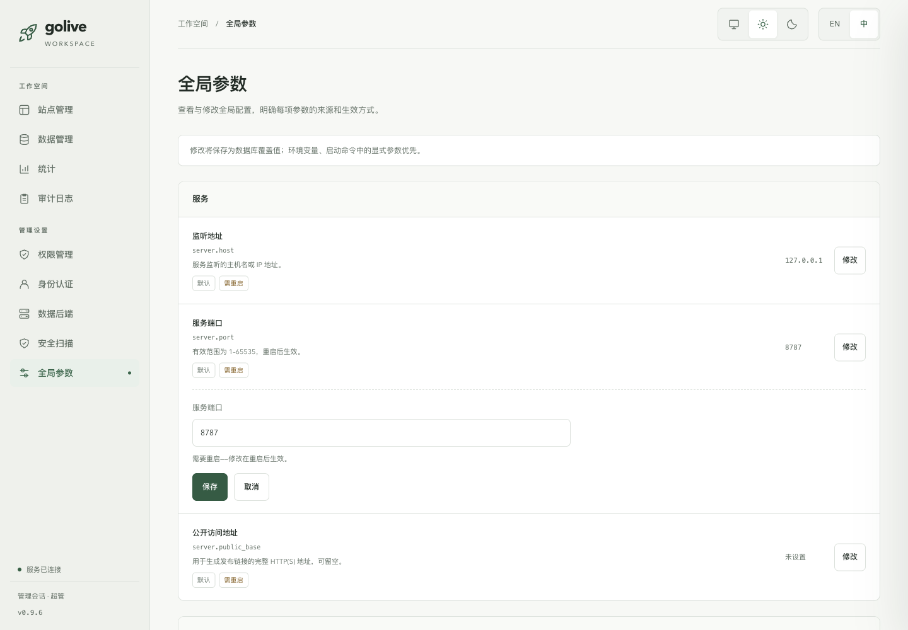
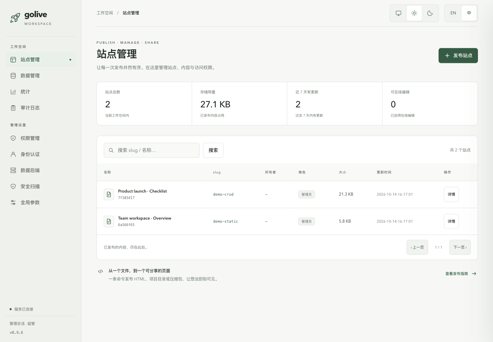
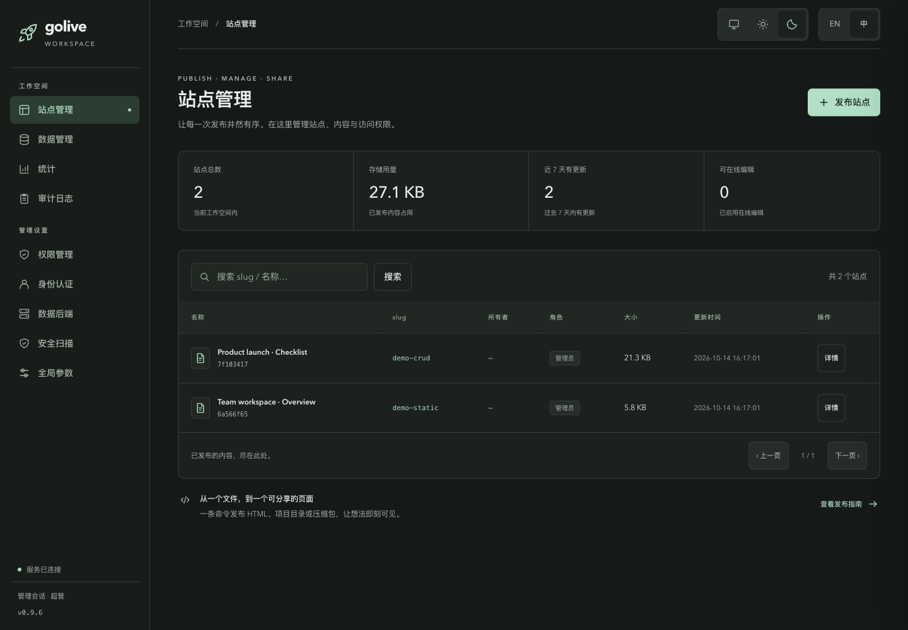
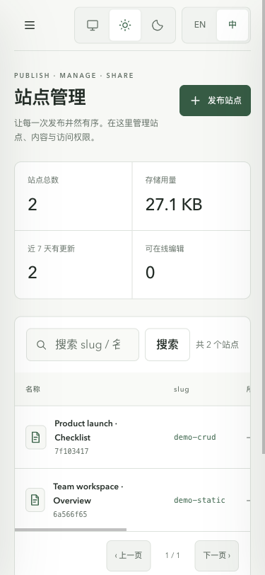

# 管理后台：静雅控制台

设计与验证日期：2026-10-14。截图已按 0.9.6 文档补丁重新采集，展示 0.9.5 的当前界面。实现位于 `golive/server/admin_ui.py`，已整合到 0.9.5，基于 0.9.4 最新发布代码；下文分轮次保留设计验证记录。

## 侧栏与连接诊断修复

已移除 Logo 下方重复的“工作空间 / 内容发布与管理”卡片。

此前 SQLite 与 Supabase 共同调用一个只处理 Supabase URL/密钥的测试函数，导致 SQLite 也被要求填写 URL。现在按选择的后端独立诊断：

- SQLite：实际检查配置中的数据库文件、完整性、读写能力；探测表和写入在事务结束时回滚。支持首次使用的空数据库及内存数据库。锁定、只读、损坏、无法打开和其他 I/O 错误有不同提示。
- Supabase：先检查 URL 和密钥配置，再只读请求 Data API 元数据；配置缺失明确说明尚未发起远程连接。认证失败、访问被拒绝、接口不存在、限流、服务异常、证书失败、超时及网络不可达分别显示，保留 HTTP 状态。
- 可见表显示数值数量；结果明确限定为 API 可达性和可见元数据，不将其扩展为表写入权限或 RLS 验收。禁用数据层时显示“无需测试”。

测试不保存项目地址或密钥，不切换后端。异常原文、远端响应正文和密钥不进入诊断结果；不跟随重定向，也不会将服务端已有密钥发给表单中的其他项目。兼容新 API 密钥与旧 JWT 密钥；连接方式参考 [Supabase API Keys](https://supabase.com/docs/guides/api/api-keys)。

本轮验证：**130 passed、19 subtests passed**。新增真实 SQLite 文件、数据保持、锁定、损坏、空数据库、内存数据库、模拟只读错误，以及 Supabase 状态码、网络异常、无效响应、密钥不回显和本地受控 HTTP 服务测试。浏览器验证 SQLite 成功、Supabase 缺配置、受控 HTTP 401 和禁用后端提示。未使用真实 Supabase 项目凭证，未声称已通过线上项目连接验收。

## 火箭标识与参数编辑更新

Logo 与 favicon 使用同一份线稿火箭路径，源文件为 `golive/server/brand.py`，沿用松绿色配色。后台通过 `/admin/favicon.svg` 提供图标。

全局参数支持逐项修改、保存、取消和恢复继承值。布尔项使用开关选项，枚举项使用下拉框，数值项按范围校验；中英文文案、深浅主题与窄屏布局统一。保存创建数据库覆盖值，恢复时使用 `DELETE /api/admin/settings/<key>` 移除覆盖；配置文件保持原样。由环境变量控制的参数标明来源并只读。

配置读取已接入数据库覆盖：热更新项在保存/恢复后更新当前运行配置；重启项保留当前运行状态，到下一次启动加载。新启动进程也会读取保存值；CLI 未显式指定端口时使用保存端口，显式启动参数和环境变量优先。水印配置影响后续发布/注入，不会自动重写已有页面。

更新验证：相关测试累计 **189 passed、12 subtests passed**，覆盖后台、配置存储、配置加载、API 权限、AI 审核和服务生命周期；新增测试验证非法批次不部分写入、环境变量优先、热更新/恢复、新进程读取与 CLI 端口优先级。浏览器实际完成浮点值/布尔值修改、刷新持久化、恢复、取消、越界提示和重启提示；验证用覆盖值已恢复。设置页在 375/768/1024/1440px 下检查布局。

## 设计方向

为日常站点发布和管理提供安静、可扫读的企业工作台。用暖白/石墨底色、松绿操作色、细线分隔和明确的标题层级组织内容；导航中的细圆点与文档形站点标记形成统一识别线索。

DFII：影响力 4、场景匹配 5、实现可行性 5、性能安全 5、一致性风险 5，总分 **14**。较大的风险项来自后台原有的多页面、动态表单与两套语言，使用共享组件样式及回归验证控制一致性。

## 组件与交互规范

| 项目 | 规范 |
| --- | --- |
| 字体 | Avenir Next 构建标题与拉丁文字层级；中文使用 PingFang SC / Noto Sans CJK SC；代码与 ID 使用 SFMono-Regular / Consolas。使用本机字体与回退，不请求外部字体。 |
| 浅色 | 背景 `#f7f8f5`，面板 `#ffffff`，正文 `#202c25`，辅助文字 `#5f6f64`，强调色 `#2c6649` |
| 深色 | 背景 `#141918`，面板 `#1b211f`，正文 `#e8eeea`，辅助文字 `#a3b2a9`，强调色 `#9bd9ba` |
| 空间 | 8px 为基础节奏，面板圆角 10–12px，按钮圆角 7px，主要操作清晰突出 |
| 导航 | 工作空间/管理设置两组；保留服务端角色决定的可见性；面包屑和页面标题同步 |
| 表格 | 标题、站点标记、短 ID、角色标签分层；窄屏在表格自身横向滚动 |
| 表单 | 标签与输入关联，JSON 就地报错；写请求期间禁用触发按钮并设置 `aria-busy` |
| 主题 | 浅色、深色、跟随系统三种偏好；首次绘制前应用主题，本机记忆偏好 |
| 反馈 | 成功/失败消息、搜索空态、清除搜索、初次加载提示；异步搜索防止旧响应覆盖新结果 |
| 浮层 | 详情抽屉提供关闭按钮、Esc、焦点约束和返回；背景不可交互；发布指南采用原生 dialog |
| 移动端 | 760px 以下为抽屉导航；小屏隐藏面包屑，保证主要控件空间 |
| 动效 | 150–220ms 的颜色/位移动效；尊重 `prefers-reduced-motion` |

概览数值来自真实 `/api/admin/stats`，只向超管展示。发布入口打开可复制命令的指南，沿用 CLI 发布流程。

## 已验证

- `tests/test_admin_ui.py` 与 `tests/test_admin_ui_v080.py`：**76 passed**，包括主题变量、中英文完整性、无外部资源、脚本语法、权限和 API 契约等既有回归。
- 真浏览器：全部九个导航页可访问；搜索无结果/清除；详情焦点、Esc 关闭；发布指南开关；语言与主题刷新后记忆。
- 数据表单：非法 JSON 显示错误；真实新增、读取、修改、删除完成；只读查看禁止修改。新增到新模型后自动切换到对应模型。验证用临时记录已删除。
- 模拟 600ms 网络延迟时，保存按钮呈禁用和忙碌状态。
- 375/768/1024/1440px 站点页无整页横向溢出；375px 下九个后台页均无整页横向溢出。
- 深浅主题的主要正文、辅助文字、导航强调及主按钮配色对比度均超过 4.5:1；受检组合最低 4.67:1。
- 本轮浏览器交互收集的脚本错误及未处理 Promise 错误为空。未做外部 OIDC、S3、PostgreSQL 或 Supabase 集成验收。

## 预览

